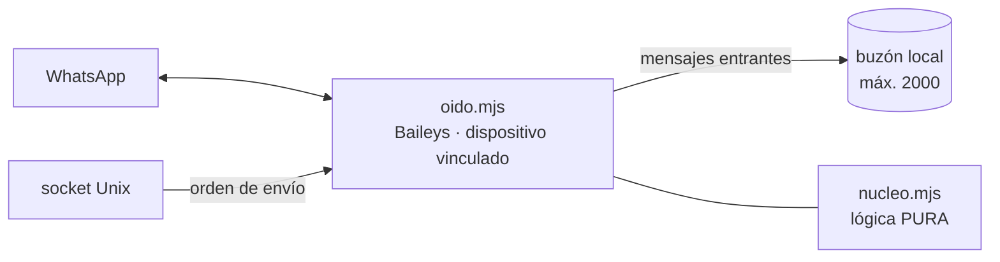

# wa-omega

**EN:** A standalone WhatsApp "ear and mouth" for a personal assistant, built on a linked device (Baileys). It
writes incoming messages to a local mailbox and sends outgoing ones through a Unix socket, with hard safety
limits. The logic is a pure module with an 83-case test bench **and a sabotage bench** that proves each rule
actually fails the tests when broken.

> ⚠️ Baileys is an unofficial WhatsApp Web client. Using it can violate WhatsApp's terms and get a number banned.
> Use a number you can afford to lose.

---

Dispositivo vinculado de WhatsApp para un asistente personal, **sin modelos y sin más red que WhatsApp**.

## Arquitectura



- `nucleo.mjs` — **toda** la lógica, sin red ni disco: qué chats entran, normalización de números, extracción de
  texto, registro del buzón, recibos de lectura y validación de envíos.
- `oido.mjs` — la parte con efectos: sesión de WhatsApp, buzón en disco y socket de envío.
- `test.mjs` — 83 pruebas sobre `nucleo.mjs`, sin WhatsApp.
- `sabotear.sh` — el **banco de sabotajes** (ver abajo).

## Reglas de seguridad (en el núcleo)

| Regla | Valor |
|---|---|
| Chats que entran | directos y grupos no silenciados; estados, canales y difusiones, nunca |
| Intervalo entre envíos | 8 s |
| Tope diario de envíos | 40 |
| Texto máximo | 4000 guardado · 2000 enviado |
| Contenido que no es texto | se **describe**, nunca se descarga |
| Números de México | se normaliza el `521` móvil; un envío puede probar ambas formas del JID |
| Logs | el cliente imprime sesiones enteras con llaves privadas; se filtran antes de llegar al log |

## El banco de sabotajes

Un test verde no prueba que el test sirva. `sabotear.sh` toma una **copia** del núcleo, rompe una regla a
propósito (por ejemplo, no quitar el `521`, o dejar entrar estados) y exige que `test.mjs` se ponga **rojo**.
Cada sabotaje que se ve `MUERDE` demuestra que esa regla está realmente vigilada.

```bash
node test.mjs        # 83/83 verdes
bash sabotear.sh     # todos deben decir MUERDE
```

## Uso

```bash
npm install
node oido.mjs vincular   # una vez, en una terminal real: muestra el QR y guarda la sesión
node oido.mjs            # servicio: recibe al buzón y envía por el socket
```

Variables: `WA_OMEGA_ESTADO` (directorio de estado), `WA_OMEGA_SOCKET` (socket de envío), `WA_OMEGA_LOG`.
`aplicar-oido.sh` instala el servicio systemd con un usuario dedicado.

## Licencia

MIT — ver [LICENSE](LICENSE).
